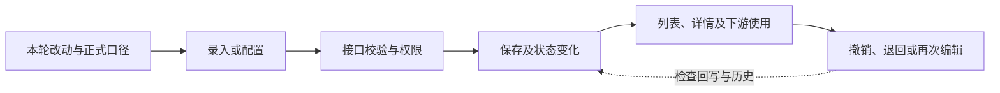

# 交测前跨层缺陷自查

目标不是把所有页面重测一遍，而是沿本轮改动的业务链路，提前发现“一个入口改对、另一入口仍错”的缺陷。只检查本轮受影响的链路；正式需求、代码和运行结果决定预期，历史缺陷只提供寻找风险的线索。

## 选自查点

先列出本轮变更的字段、动作、角色和受影响页面，再从下表挑最可能失配的两三条路径。每条路径用一个能区分正确与错误实现的样本走到最终结果；仅保存成功或单页回显不算走通。

| 变化信号 | 优先探针与易漏点 |
| --- | --- |
| 字段、单位或显示口径变了 | 比对新增/编辑、列表、详情、历史空值和下游取值；确认标签、类型、计算展示与落库含义一致。只改展示时，不意外改计算或存储。 |
| 输入约束或业务条件变了 | 区分空、全空白、零、负数、小数、上限及超长；看前端提示与服务端拒绝是否同口径。先辨明软建议还是硬约束、保存时还是提交时校验，避免“静默修正”非法值。 |
| 主数据引用、候选范围或权限变了 | 用普通角色而非仅管理员走入口；构造可选、已占用、停用或不存在的对象，检查候选列表与服务端守卫。候选有分页或数量上限时，确认不会静默漏掉合法项。 |
| 审批、作废、反审核或退回变了 | 检查动作前置条件、原因必填、反向回写、历史快照与审计信息的可见性；分清“已修待验证”和实际已验证。流程配置还要走到发布及真实办理结果。 |
| 列表、弹窗或长表单布局变了 | 关键状态和可点入口能否看到、点到；检查长名称完整信息、只读呈现、返回时未保存内容，以及一次布局调整是否遮住相邻列。按项目支持的屏宽验证，不把所有窄屏都设为硬门槛。 |

## 收口

记下受影响路径、所用角色和样本、观察到的结果、尚未覆盖的边界。发现问题再进入缺陷修复闭环；自查通过只说明这些探针通过，不代替测试人员验收，也不把来源台账的“已修待验证”升级为“已验证”。
