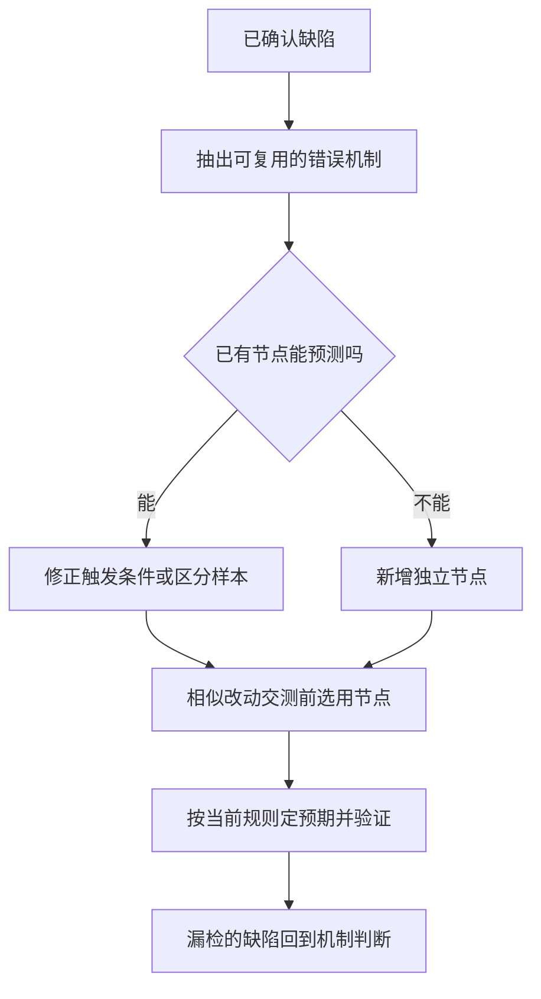

# 从缺陷经验生长交测前识别树

目标是让已确认缺陷改变下一次交测前的自查，而不是持续收集缺陷清单。先问：**本轮改动可能出现哪种看起来能用、但实际错误的实现？什么最小样本能让它与正确实现得到不同结果？** 预期须从当前有效需求、产品确认或接口契约独立确定，不能照着实现倒推。用户只要测试方向时，交付方向与样本，不擅自操作系统。

## 让缺陷成为识别节点

树按**错误机制**生长，不按项目、模块或缺陷编号生长。一个节点说清触发它的变化、可能蒙混过关的错法、让对错分叉的最小样本，以及应从哪里独立确定预期。具体数据和修复经过留在原项目；未经确认的归因不入树。

新缺陷先找现有节点能否预测：能预测但没查到，就修正触发条件或样本；确有不同机制且可跨任务复用，才增加节点。若节点本来已足够、只是本轮未执行，应修正交测前的使用方式，不复制一条同义规则。未确认或已判非缺陷的报告可用于澄清适用边界，不能当成已证实的错误模式。

## 交测前使用识别树

下表是可复用的起始节点，不是必测清单。按本轮变化选相关节点；如果正确和错误实现都会通过该样本，换样本或不列为重点。

| 分支与触发变化 | 可能蒙混过关的错法 | 区分性样本与观察 |
| --- | --- | --- |
| 输入约束改变 | 控件与服务端值域不同，或控件静默钳制、截断 | 按已确认语义选空、默认值、零、负数、精度、上限及上限外一格；看控件实际值、请求和保存结果。关联字段只填一边时也能暴露成对约束缺口。 |
| 保存与最终动作的校验改变 | 把最终约束提前到可暂存阶段，或只在暂存时检查 | 用同一份未完成数据分别执行暂存和最终动作，核对各阶段独立的允许条件与结果。 |
| 自动带出或派生值改变 | 首次结果正确，换源、改值或再次执行后仍保留旧结果 | 用不同来源或非整除值，先执行一次再切换、改回，保存后重开；比较最终值，不只看即时显示。 |
| 状态与反向动作改变 | 主对象状态已变，关联对象仍沿用旧限制 | 正向执行后再退回、撤销或终止，检查关联对象状态，并尝试按规则应当可行的后续操作；提示正确不代表联动正确。 |
| 候选查询或列表改变 | 少量数据正常，超过隐含数量上限后漏项 | 准备跨过当前查询边界的命中与未命中项，核对后续页或搜索能否找到目标，并确认权限与范围。 |
| 字段展示或入口改变 | 某个页面有值，其他入口显示错误或功能实际不可用 | 对同一概念检查列表、选择器、新增/编辑、详情及旧数据；区分标识和值的展示含义，确认入口真实可见可点，而非只在 DOM 中存在。 |

观察按风险延伸到**控件实际值 → 请求/响应 → 保存后读取 → 受影响的下游**，不要求每个小文案都查数据库。瞬时提示先用截图、监听或请求证据复核，避免把没捕获到当作没出现。

## 结果判定

用例步骤或原型与当前确认规则冲突时，先核对预期，不照单提缺陷；场景无法从用户入口构造时，标为未覆盖或转到合适的接口层验证，不虚构一次通过。区分“功能确实错误”“用例预期过时”“产品口径未定”“证据不足”，并注明哪些断言仅部分通过。一次修复或一轮自查不能自动升级为人工已验收。

给 Agent 的简短输入可写成：

> 请把本轮改动映射到缺陷识别树中相关的错误机制。对每个选中的节点，给出可能蒙混过关的错法、能让对错分叉的最小样本、独立的预期来源和最终观察点；交测前优先自查这些样本。若仍发现同类缺陷，判断是节点缺失、样本失效还是执行遗漏，再决定如何更新识别树。预期未定或证据不足的，单列待确认。
