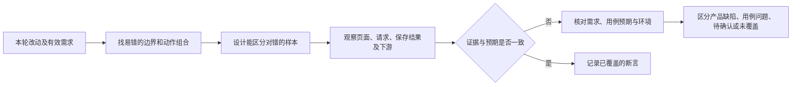

# 用测试工程师的视角做交测前自查

先回答“该测什么、怎样才能测出错”，再决定是否执行。历史缺陷提供选场景的经验，**不提供当前项目的预期答案**；以当前有效需求、产品确认和实际接口契约确定预期。用户只要测试方向时，交付方向与样本，不擅自操作系统。

## 优先给 Agent 的测试方向

按本轮变化选择相关方向，不机械跑完所有行；每个方向至少说清预期来源、一个能区分对错的样本，以及需要观察的最终结果。

| 变化类型 | 测试工程师常用的切入方式 |
| --- | --- |
| 输入或业务约束 | 测空、默认值、零、负数、精度、上限及上限外一格；有关联字段时只填一边，明细测零行/一行/多行。观察控件是否偷偷钳制或截断，以及服务端是否同口径拦截、给出可理解的错误。先确认零、空、默认值在该场景的真实语义。 |
| 自动带出、计算与联动 | 改一个源值后看派生值；再切换来源、修改已有行、改回原值、保存后重开。重复查询时用先宽后窄的条件，辨别应“替换”却变成“累积”。用非整除、不同值样本区分计算、精度和百分比展示；不要只看表单内即时显示。 |
| 状态与反向动作 | 走保存、提交、审批、退回、作废或反审核中与改动相关的路径；核对必填原因、按钮可用范围、状态、汇总回写和审计留痕。提示文案正确不证明最终数据正确，正向通过也不证明反向已还原。 |
| 字段与页面入口 | 对同一概念检查列表、选择器、新增/编辑、详情、校验提示和旧数据；区分“同名不同义”字段。检查功能入口真实可见可点，而非 DOM 中存在；检查表单默认值会不会令某个异常用例在 UI 上不可构造。 |

观察按风险延伸到**控件实际值 → 请求/响应 → 保存后读取 → 受影响的下游**，不要求每个小文案都查数据库。瞬时提示先用截图、监听或请求证据复核，避免把没捕获到当作没出现。

## 结果判定

用例步骤或原型与当前确认规则冲突时，先核对预期，不照单提缺陷；场景无法从用户入口构造时，标为未覆盖或转到合适的接口层验证，不虚构一次通过。区分“功能确实错误”“用例预期过时”“产品口径未定”“证据不足”，并注明哪些断言仅部分通过。一次修复或一轮自查不能自动升级为人工已验收。

给 Agent 的简短输入可写成：

> 请按当前有效需求和本轮改动，先提出最值得测的几条方向。每条说明预期从哪里来、用什么边界或动作组合区分正确与错误、应观察页面/请求/保存结果中的哪些证据；特别留意默认值使异常场景不可构造、输入被静默改写、重复操作与反向动作。若预期不明或证据不足，请单列待确认，不把它当已证实的产品缺陷。
