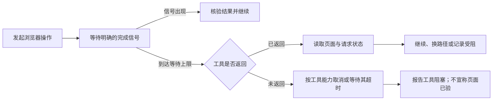

# Run AI UI Walkthrough

核心问题是 Agent 在“等页面”或“等工具”时停住，不再推进。**每次等待都应有完成信号和退出条件；到时未满足，就检查状态、换路径或报告受阻，不静默续等。** 点击、键入、弹层等技巧只服务于这个判断。

## 等待什么，何时退出

- 多页面走查先给用户一个简短步骤与受阻后的处理方式。每次操作选择能证明目标已达到的信号，如特定元素出现、URL 改变、请求返回或列表内容更新；按环境为等待设合理上限。不要用固定睡眠或笼统的“等页面稳定”代替信号。
- 例如点“查询”后，等目标请求或列表变化；上限到了仍无变化，就读取输入框实际值、请求参数和当前页面。若输入根本没生效，不把“查询无结果”判成产品缺陷。
- 工具调用本身未返回，与工具已返回但页面未就绪是两类阻塞。前者只在工具支持时取消或设调用级超时；无法中断时如实说明阻塞，不能靠持续等待或重发同一调用假装推进。

## 退出等待后的判断

- 先核对实际页面状态再重试。多个弹层叠开时，查清当前有效弹层，在其内部定位按钮和输入框；导航刚发生时重新获取页面状态。重复同一操作却没有新证据，就换定位、输入方式或测试数据，不循环空试。
- 输入可尝试真实键入或框架支持的设值方式，但程序化设值可能绕过 `maxlength` 等用户限制。换路径可以让走查继续，**不能代替原用户路径报通过**；先确认操作确实生效，再判断产品结果。
- 走查范围内的保存、提交或审批依用户授权和测试目标执行，不由本 Skill 一概禁止。验证非法输入时，前端拦截可能表现为零请求，服务端拦截也可能表现为拒绝响应；按已确认规则判断，并检查业务状态未被意外改变。

确认是产品缺陷时记录缺陷，不以绕路掩盖；确认是工具阻塞或操作未生效时记录未验证，不宣称页面已通过。
